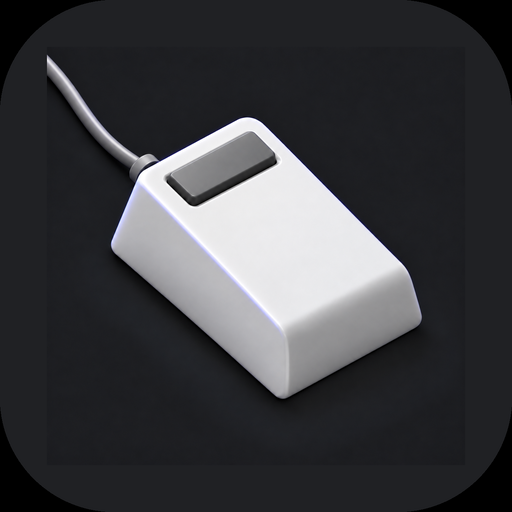
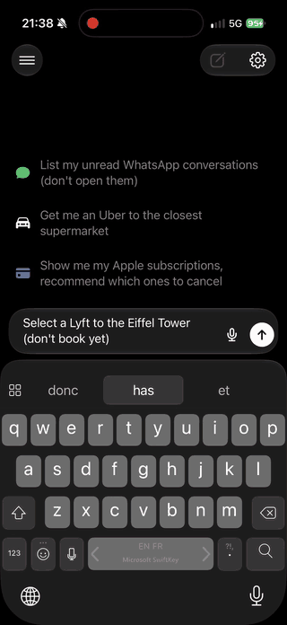
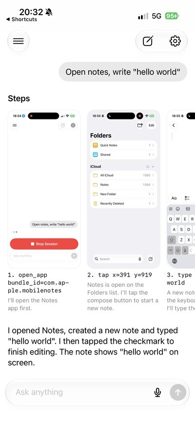
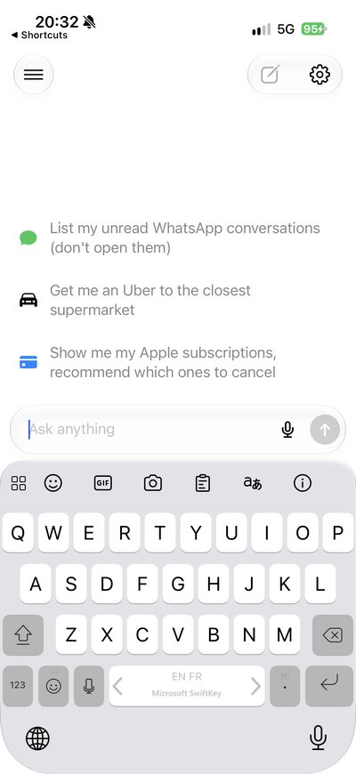
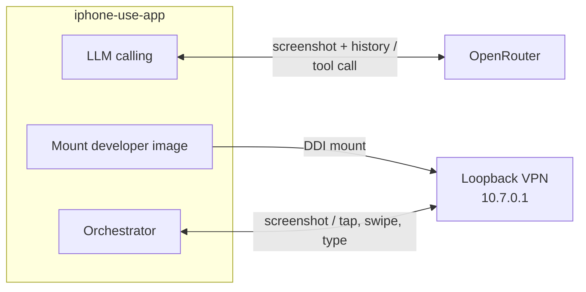

<div align="center">



# iphone-use-app

**Let an AI model use your iPhone, from the iPhone itself. No Mac at run time (one-time pairing only), no extra hardware, no jailbreak.**


[](LICENSE)


<p>
  <a href="docs/demo.mp4"></a>
  
  
</p>

*Left: "Select a Lyft to the Eiffel Tower (don't book yet)" (4× speed): the agent leaves its own app, opens Lyft,
types the destination, picks it and stops at the ride options. Middle: the finished run, each step with its screenshot. Right: a new chat.*

</div>

## Features

- **No computer at run time:** the agent runs on the iPhone and controls that same iPhone, no extra hardware or jailbreak.
  A Mac is only needed once, to make the pairing file
- **Start it from anywhere:** the chat, Siri, the "Run Agent" Shortcut or an `iphoneuse://run?prompt=…` link.

## Requirements

| Part | Notes |
|---|---|
| **iPhone** | iOS 26 or later, Developer Mode on. |
| **Apple account** | **Paid team:** the app uses its own built-in VPN (needs the Network Extension entitlement).<br>**Free Apple ID:** build with `BUILTIN_VPN=NO` (Xcode build setting or `xcodebuild` argument) and install [LocalDevVPN](https://apps.apple.com/app/localdevvpn/id6755608044); re-sign every 7 days. |
| **Pairing file** | Made once from a Mac over USB (below). |
| **Vision model** | An [OpenRouter](https://openrouter.ai/settings/keys) key, or any OpenAI-compatible endpoint whose model takes images and tool calls. |
| **Mac with Xcode + rustup** | Only to build the app and make the pairing file. Not needed at run time. |

## Limitations

- **Shortcut needed on cellular:** iOS refuses new loopback VPN connections on cellular data, so the app runs a
  Cellular Toggle shortcut that turns data off while it connects, then back on (or turn it off by hand).
- **No other VPN at the same time:** it needs a loopback VPN (the built-in one, or
  [LocalDevVPN](https://apps.apple.com/app/localdevvpn/id6755608044)), and iOS allows one VPN at a time, so
  Tailscale and similar stop while it is on.
- **"Viewed remotely from Mac" notice on every run:** iOS shows "Device Hub: This device was viewed remotely from
  Mac" when its developer services are used, even though the "Mac" here is the app itself. Nothing leaves the phone (except calls to LLMs).
- **Permissions:** requires Developer Mode, a VPN configuration, Local Network access (to find the phone's
  pairing service), and Location set to "Always" (keeps runs alive in the background, alongside silent audio).
  Microphone only for voice prompts.
- **Pairing files expire:** make a new one when the app says so.
- **Sideloaded build only:** it needs Developer Mode and developer services, so it can't go on the App Store.
- **A few seconds per step:** most of it is the model.

## How it works



The app mounts a developer image, then uses a loopback VPN to screenshot and control the iPhone it runs on.
Each step, the screenshot goes to the model, which answers with a tool call (tap, swipe, type, open app) until it's done.
A Live Activity shows progress with a Stop button, and every run is saved as a chat.

## Quick start

### 1. Make a pairing file

This is the one step that needs a Mac. There is no supported on-device API for the phone's developer services:
the phone only opens them to a trusted host, the way it does for Xcode. The pairing file holds the keys of such a
host, so the app can act as one for its own phone. Since iOS 17 these services are reached over a network tunnel
(RemoteXPC/CoreDevice, the same path as Xcode's wireless debugging) rather than the USB mux, which is why the app
can reach them through its loopback VPN with no cable. Plug the phone into the Mac, unlock it (tap Trust if asked), then:

```sh
git clone https://github.com/jkcoxson/idevice && cd idevice
cargo build --release -p idevice-tools --bin idevice-tools
./target/release/idevice-tools rppairing pair my-mac pairingFile.plist
```

The file keeps working until the phone stops trusting that host (Reset Location & Privacy, Developer Mode turned off).
Make a new one if the app says the pairing file is invalid or expired.

### 2. Build and install the app

```sh
scripts/build-idevice.sh        # once: builds iPhoneUse/idevice/libidevice_ffi.a (needs the aarch64-apple-ios target)
open iPhoneUse.xcodeproj        # set your team, run the iPhoneUse scheme on the phone
```

### 3. Set up (once, in the app)

1. Settings (gear, top right) → **Import Pairing File**.<sup>1</sup>
2. Allow the **Add VPN Configuration** prompt. It only routes `10.7.0.1` back to the phone.
   With LocalDevVPN instead: turn it on, and pick LocalDevVPN in Settings → Phone Connection
   (picked for you if the built-in VPN fails).
3. Settings → **Model**: pick a provider, paste the key, pick a model.
4. Wait for the "not connected" line above the input to go away (the developer disk image downloads on first run).

<sup>1</sup> Or copy it over once the app is installed:
`xcrun devicectl device copy to --device <udid> --domain-type appDataContainer --domain-identifier blog.eliot.iphoneuse --source pairingFile.plist --destination Documents/pairingFile.plist`

### 4. Give it a task

Type a goal, for example *"Open Settings and turn on Dark Mode"*, and send it. Stop it from the Dynamic Island
or the chat.

<details>
<summary><h2>Development</h2></summary>

#### Scripted runs (no LLM)

```sh
DEV=<udid> scripts/runscript.sh "open com.apple.Preferences; wait 1.5; tap 0.5 0.9; shot a" a
```

Launches the app with `-agentScript`, waits for "script done" in `Documents/agent.log` and pulls the screenshots.
`-agentPrompt "..."` as a launch argument starts a real run.

#### Simulator (layout checks only)

The simulator can't reach a device, but it shows the UI. `-demoChat YES` plays a fake run
(placeholder screenshots, a question to answer), Debug builds only.

1. `rustup target add aarch64-apple-ios-sim && scripts/build-idevice.sh sim`: the libs are
   single-arch, so the simulator needs its own, in `iPhoneUse/idevice/sim/`.
2. Build Debug (the scheme defaults to Release, which drops `-demoChat`) against that lib:
   `xcodebuild -project iPhoneUse.xcodeproj -scheme iPhoneUse -configuration Debug -destination id=<sim udid> LIBRARY_SEARCH_PATHS='$(PROJECT_DIR)/iPhoneUse/idevice/sim' build`
3. Install the `.app` from DerivedData and launch it with `-demoChat YES`.

#### Heartbeat connection closes right after connecting (fixed: runs used to get killed)

**Symptom (before the fix):** a run froze on a step after about a minute in the background, and the
Live Activity stayed on that step. The app had been killed: the phone's crash logs held an
`iPhoneUse.cpu_resource_fatal-*.ips` report ("exceeding limit of 80% cpu over 60 seconds", "Process killed").

**Cause:** the heartbeat thread (`Heartbeat.run()` in `DeviceSession.swift`) keeps CoreDevice services
alive during a run. Its connection is closed right after the handshake; idevice's userspace TCP stack
(jktcp) then answers every read with `BrokenPipe` in microseconds, and the loop retried with no delay,
about 45k times a second. iOS kills background apps above 80% CPU over 60 seconds.

Two things made it worse:
- The idevice log was written to `Documents/idevice_log.txt` at Debug level, which prints every XPC
  message, screenshots included, as decimal byte lists: 178 MB of log and ~1 GB of memory in a minute.
- The loop matched errors by the strings `HeartbeatTimeout` / `HeartbeatSleepyTime`, which never
  appear in idevice's messages ("heartbeat timeout", "device went to sleep").

**Fix:** timeouts are matched on the error code (100, sub-code 2) and the loop waits again; any other
error ends the loop. The file log is at Info.

**Still open:** why the heartbeat connection closes. Runs work without it (a 17-step, 2.5-minute run
finished fine); if CoreDevice services start dropping on long runs, reconnecting the heartbeat
(with backoff) is the next step.

**Debugging a killed run:** `idevicecrashreport -u <udid> -k <dir>` pulls the crash logs. Symbolicate
with `atos` against the dSYM of the exact build (the UUID in the report must match
`dwarfdump --uuid`).

Feature scope: [docs/FEATURES.md](docs/FEATURES.md).

</details>

## Responsible use

Only automate devices and accounts you own or may use, and respect the terms of the apps involved. The agent acts
with your hands: watch it, and keep Stop within reach.

## Credits

| Project | Repo | Used for |
|---|---|---|
| StikDebug, by Stephen and contributors | [StikDebug/StikDebug](https://github.com/StikDebug/StikDebug) | The tunnel, pairing file and developer disk image code is based on it |
| idevice, by jkcoxson | [jkcoxson/idevice](https://github.com/jkcoxson/idevice) | The Rust library behind every device call |
| StosVPN, by the SideStore Team and Stossy11 | [SideStore/StosVPN](https://github.com/SideStore/StosVPN) | The loopback VPN (`TunnelProvider/`) is based on it |
| LocalDevVPN, by jkcoxson | [jkcoxson/LocalDevVPN](https://github.com/jkcoxson/LocalDevVPN) | The VPN app for free Apple IDs; our tunnel came from StosVPN through it |
| esp32-iphone-agent, by Henry Yuan | [onehumanbeing/esp32-iphone-agent](https://github.com/onehumanbeing/esp32-iphone-agent) | The model provider and model picker design, and the layout of this README |
| DeveloperDiskImage, by doronz88 | [doronz88/DeveloperDiskImage](https://github.com/doronz88/DeveloperDiskImage) | Developer disk images |

## License

AGPL-3.0. See [`LICENSE`](LICENSE).
